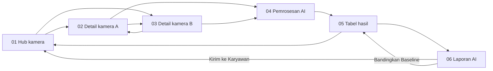

# Spesifikasi desain HEALY Studio

HEALY Studio adalah dashboard skrining ergonomi workstation melalui beberapa kamera. Alur utamanya mencakup pemilihan kamera, persiapan rekaman, pemrosesan AI, tabel hasil, dan laporan per sesi.

Dokumen ini memakai [design.figcraft](./design.figcraft) sebagai sumber ukuran, warna, font, teks, dan interaksi. Enam screenshot menjadi acuan tampilan. Semua koordinat dan ukuran memakai piksel pada frame asli, dengan titik awal di kiri atas frame; ukuran screenshot mengikuti zoom aplikasi.

Identitas pekerja, hasil analisis, verifikasi petugas, dan kebijakan privasi merupakan isi contoh dalam prototipe. Bagian responsif dan aksesibilitas berisi usulan implementasi karena sumber hanya menyediakan desain desktop.

## Daftar layar

| No. | Halaman Figcraft | ID frame | Subjudul merek |
| --- | --- | --- | --- |
| 01 | Pusat Kamera Workstation (Multi-Cam Hub) | `100` | Multi-Camera Hub |
| 02 | Detail Kamera A (Pod Engineering) | `222` | Ergonomics K3 |
| 03 | Detail Kamera B (Pod Operations) | `371` | Ergonomics K3 |
| 04 | Status Sedang Diproses AI | `520` | AI Processing Engine |
| 05 | Output Tabel Hasil (Day / Week) | `608` | Output Hasil Analisis |
| 06 | Laporan AI Lengkap (Video Report) | `758` | AI Ergonomic Report |

Semua frame berukuran `1568 × 1176`. Nama halaman dan nomor di luar artboard pada screenshot termasuk antarmuka editor Figcraft.

## Gaya visual dan token

Gunakan latar abu-abu dengan wadah aplikasi putih yang membulat. Aksen lime menandai merek, pilihan, dan beberapa aksi utama. Area kamera memakai navy gelap dengan ilustrasi pose berupa garis dan titik. Kartu informasi memakai border tipis; sumber tidak memakai bayangan dekoratif atau gradien.

Nama token berikut merupakan penamaan untuk dokumen ini. File sumber belum mendefinisikan shared styles atau variables.

### Warna

| Token | Nilai sumber | Penggunaan |
| --- | --- | --- |
| `canvas` | `#E2E5E8` | Latar artboard di luar wadah aplikasi |
| `surface` | `#FFFFFF` | Wadah aplikasi dan kartu |
| `surface-muted` | `#F8FAFC` | Field, kepala tabel, metadata, dan kartu privasi |
| `control-muted` | `#F4F5F7` | Tombol ikon dan tombol abu-abu |
| `border` | `#ECEFF2` | Border kartu dan sidebar |
| `border-input` | `#E2E8F0` | Border field dan tombol lembut |
| `border-control` | `#E5E7EB` | Border tombol outline dan track progres |
| `accent` | `#D4F038` | Merek, tombol lime, skeleton, dan progres |
| `ink` | `#111827` | Judul, tombol gelap, dan latar kamera |
| `preview-overlay` | `#1F2937` | Toolbar dan label di area kamera |
| `preview-control` | `#374151` | Tombol kamera, kepala ilustrasi, dan bidang monitor |
| `text-secondary` | `#4B5563` | Isi pendukung dan ikon |
| `text-muted` | `#6B7280` | Metadata dan label |
| `text-placeholder` | `#9CA3AF` | Subtitle, placeholder, dan tahap menunggu |
| `success` | `#10B981` | Indikator siap, hasil optimal, dan tahap selesai |
| `success-soft` / `success-ink` | `#D1FAE5` / `#065F46` | Badge risiko rendah atau optimal |
| `warning` | `#F59E0B` | Garis pose peringatan dan border tahap aktif |
| `warning-soft` / `warning-ink` | `#FEF3C7` / `#92400E` | Badge sedang dan panel peringatan |
| `danger` | `#EF4444` | Indikator live, rekam, dan hasil berisiko |
| `danger-soft` / `danger-ink` | `#FEE2E2` / `#991B1B` | Badge live dan risiko tinggi |
| `info` | `#2563EB` | Penekanan protokol dan teks verifikasi |

Latar halaman editor adalah RGB `(0.94, 0.95, 0.96)`; latar artboard aplikasi memakai `canvas`.

### Tipografi

Seluruh teks memakai Inter dengan letter spacing `0%` dan line height otomatis pada sumber. Gunakan bobot Regular `400`, Medium `500`, Semi Bold `600`, Bold `700`, dan Extra Bold `800` sesuai peran teks.

| Peran | Ukuran | Bobot |
| --- | --- | --- |
| Persentase progres utama | `44` | Extra Bold |
| Angka kartu ringkasan | `36` | Bold atau Extra Bold |
| Judul detail kamera | `34` | Bold |
| Judul hub kamera | `30` | Bold |
| Judul pemrosesan, hasil, dan laporan | `28` | Bold |
| Subtitle detail kamera | `18` | Regular |
| Subtitle hub dan satuan kartu ringkasan | `16` | Regular sampai Semi Bold |
| Judul kartu | `14–15` | Bold |
| Merek, label field, tombol, dan isi tabel | `12–13` | Medium sampai Extra Bold |
| Metadata, badge, dan kepala tabel | `10–11` | Medium sampai Bold |

Pada kartu ringkasan, angka dan satuan memiliki ukuran berbeda. Contoh: `48` berukuran `36`, sedangkan `Sesi` berukuran `16`. Pada tabel, nama pekerja tebal dan ID pekerja berwarna muted dalam baris yang sama.

### Bentuk dan jarak

| Elemen | Ukuran atau radius sumber |
| --- | --- |
| Wadah aplikasi | Radius `36` |
| Kartu standar | Radius `24`, border `1.5` |
| Kartu ringkasan dan metadata laporan | Radius `20` |
| Panel kamera detail | Radius `28` |
| Panel pemrosesan | Radius `32` |
| Preview kamera kecil | Radius `16` |
| Field | Tinggi `40`, radius `12` |
| Tombol dan tab | Tinggi `36–52`, radius setengah tinggi |
| Ikon toolbar | Lingkaran `40 × 40`; menu `44 × 44` |
| Penanda judul kartu | Kotak lime `16 × 16`, radius `4` |

Padding kartu umumnya `20–25`. Jarak antarkolom pada detail dan laporan adalah `20`; grid kamera memakai jarak `25`. Pertahankan ruang kosong yang terlihat pada screenshot, termasuk area bawah tabel hasil.

## Kerangka aplikasi bersama

| Area | Posisi dan ukuran sumber |
| --- | --- |
| Wadah aplikasi | `x: 48`, `y: 48`, `1472 × 1080` |
| Merek | `x: 84`, `y: 78`, `225 × 48`; lebar `195` pada detail kamera |
| Sidebar | `x: 84`, `y: 190`, `56 × 490`, radius `28` |
| Kolom konten | Mulai `x: 175`, lebar `1275`, berakhir di `x: 1450` |
| Area judul | Sekitar `y: 189–250` |
| Awal panel utama | `y: 275` atau `280`, sesuai layar |

Toolbar atas menampilkan logo HEALY dalam lingkaran navy, nama HEALY Studio, subjudul halaman, dan chevron di dalam kapsul lime. Di sebelahnya ada ikon stetoskop, refresh, dan centang. Sisi kanan memuat ikon hati, kilau, lonceng, kapsul tanggal, serta menu hamburger navy.

Tanggal contoh adalah `Kamis, 5 Nov`. Badge hitungan bernilai `4` pada hub dan `3` pada layar lain. Sumber tidak menjelaskan arti hitungan tersebut.

Sidebar memakai tombol ikon bundar. Item kamera aktif pada layar 01–03, AI aktif pada 04 dan 06, dan ikon tabel aktif pada 05. Item lain menampilkan simbol HEALY, CVA atau AI, Dept atau Trunk, K3, riwayat, serta simbol lapisan atau kode sesuai halaman. Detail kamera dan laporan memiliki kontrol fullscreen serta panah diagonal di kiri bawah.

Pertahankan bentuk ikon garis tipis dengan ujung membulat. Logo dan ilustrasi pada sumber berupa vektor; arsip tidak menyediakan foto atau rekaman kamera asli.

## Layar 01: hub kamera

Judulnya Pusat Kamera Workstation (Multi-Camera Hub), dengan subtitle Pilih Kamera Stasiun Kerja untuk Memulai Perekaman & Skrining Ergonomi AI. Di kanan judul terdapat kapsul `4 Kamera Online` dengan titik merah, filter `Semua Pod`, dan tombol navy `+ Tambah`.

Grid berisi dua kolom. Kartu A dan B berada pada `y: 275`, berukuran `625 × 370`; kartu C dan D berada pada `y: 670`, berukuran `625 × 360`. Kolom kiri mulai `x: 175`, kolom kanan `x: 825`.

| Kamera | Pod dan meja | Pekerja | Perangkat pada hub | Sudut |
| --- | --- | --- | --- | --- |
| A | Engineering, B-12 | Priyapta Naufal, `#EMP-8021` | Logitech Brio 4K | Lateral 90° |
| B | Operations, O-04 | Sarah Jenkins, `#EMP-7402` | USB Cam 02 | Lateral 90° |
| C | Support, S-08 | Dimas Aditya, `#EMP-8109` | Logitech C920 | Frontal 0° |
| D | Design, D-02 | Jessica Tan, `#EMP-6920` | Brio 4K | Lateral 85° |

Setiap kartu menempatkan penanda kotak dan nama kamera di kiri atas, badge merah muda `LIVE FEED` di kanan atas, preview navy, lalu identitas pekerja dan tombol buka kamera di bawah. Penanda A/B berwarna lime dan C/D abu-abu, sementara semua kartu menampilkan label live.

Preview A/B berukuran `585 × 240`; C/D `585 × 230`. Label sudut berada dalam kapsul gelap di kiri atas preview. Ilustrasi A memakai garis lime, B memadukan hijau dan amber, C menampilkan garis tubuh hijau serta garis bahu amber, dan D memakai garis tubuh hijau. Kepala berbentuk oval abu-abu.

Tombol buka kamera berukuran `200 × 42`: A lime, B navy, C/D abu-abu dengan border. Kartu dan tombol A menuju layar 02, sedangkan B menuju 03. File belum memberi aksi pada C/D, filter pod, atau tombol tambah; warna abu-abu saja tidak menetapkan kamera offline.

## Layar 02 dan 03: detail kamera

Kedua layar memakai judul Analisis Postur Baru dan tata letak yang sama. Subtitle A menampilkan Pod Engineering B-12 serta Priyapta Naufal; subtitle B menampilkan Pod Operations O-04 serta Sarah Jenkins.

### Susunan panel

| Area | Posisi | Ukuran |
| --- | --- | --- |
| Panel preview | `175, 280` | `840 × 760` |
| Toolbar di dalam preview | `195, 300` | `800 × 42` |
| Parameter asesmen | `1035, 280` | `415 × 230` |
| Protokol kamera | `1035, 530` | `415 × 190` |
| Persetujuan dan privasi | `1035, 740` | `415 × 210` |
| Aksi pemrosesan di kanan | `1035, 970` | `415 × 52` |

Pemilih kamera berada di kanan judul. Pada layar A, kapsul lime bertuliskan `Kamera A (Aktif)` dan tombol outline bertuliskan `Pindah ke Kamera B`. Pada layar B, kapsul A tetap lime dengan label `Kamera A`, sedangkan tombol outline bertuliskan `Kamera B (Aktif)`. Pertahankan perbedaan ini untuk reproduksi sumber; lihat catatan konsistensi sebelum menjadikannya pola pilihan aktif.

### Isi preview

Toolbar preview menampilkan titik merah, `LIVE CAMERA FEED`, metadata `1080p @ 30fps`, nama perangkat, dan badge `Lateral 90° View`. Ilustrasi utama memperlihatkan pekerja duduk menghadap monitor di atas meja, kursi di belakang, dan garis lantai.

Skeleton lime memiliki titik pada sendi. Bingkai deteksi di posisi `475, 460` berukuran `270 × 375`, radius `16`, dengan border lime `1.8` dan pola putus-putus `6, 6`. Label lime di atasnya berbunyi `Posisi Tubuh Pas di Bingkai`.

Di bawah ilustrasi ada empat kapsul status gelap dengan titik hijau: `Pencahayaan Stabil`, `Jarak Kamera: 1.8m`, `Sudut: Lateral 90° (Tepat)`, dan `Subjek: 1 Orang Terdeteksi`. Baris tersebut mulai pada `195, 920`, dengan tinggi `36`.

Baris kontrol pada `195, 975` memiliki tinggi `46`. Urutannya adalah tombol abu-abu `Flip Mirror` selebar `130`, pemilih perangkat selebar `260`, dan tombol lime `Mulai Rekam Sesi Skrining (Max 15 Menit)` selebar `380` dengan titik merah.

### Panel kanan

Parameter Asesmen Workstation memuat dua field berlatar lembut: Tipe Posisi Kerja dan Identifikasi Pekerja (Privasi). Nilai posisi kerja adalah `Meja Kerja Duduk Standar (Seated Workstation)`. Nilai identitas pada sumber memakai `Karyawan Anonim`, departemen, dan ID pekerja.

Protokol Sudut Kamera K3 menjelaskan penggunaan tampak samping lateral 90° untuk CVA dan trunk flexion, serta tampak depan frontal 0° untuk elevasi atau asimetri bahu. Label lateral berwarna biru; isi penjelasan berwarna abu-abu. Teks panjang perlu membungkus di dalam kartu saat implementasi.

Kartu Persetujuan & Kebijakan Privasi K3 menampilkan tiga kotak centang terpilih. Copy desain menyebut ekstraksi titik pose tanpa pengenalan wajah, akses video oleh petugas K3 yang berwenang, dan penghapusan data setelah 30 hari. File tidak memodelkan perubahan persetujuan.

Tombol navy `Rekam & Jalankan Pemrosesan AI` memiliki ikon panah lime dalam lingkaran abu-abu di kanan. Kedua tombol rekam pada tiap layar langsung menuju layar 04 dalam prototipe. Sumber belum menyediakan tampilan rekaman berlangsung, penghentian rekaman, atau hasil perubahan perangkat.

## Layar 04: pemrosesan AI

Header menampilkan konteks Pipeline Pemrosesan Video / Sesi Kamera A dan judul Sedang Diproses oleh AI (Inferensi Vision). Badge amber di kanan bertuliskan `Inferensi AI Sedang Berjalan`.

Panel utama berada di `310, 280`, berukuran `1000 × 730`, dengan radius `32`. Susun isi di tengah area konten: simbol HEALY dalam lingkaran berlapis, persentase, penjelasan proses, progress bar, daftar tahap, dan tombol hasil.

Lingkaran indikator berdiameter `150`, `110`, dan `76`, memakai lime dengan opacity `20%`, `40%`, dan `100%`; pusatnya adalah lingkaran navy `32`. Nilai besar berbunyi `78% SELESAI`, dengan teks pendukung analisis `9.000` frame dan estimasi sisa sekitar `4 detik`.

Progress bar berada di `430, 575`, berukuran `760 × 12`. Track abu-abu, isian lime selebar `590`, dan penanda ujung berupa lingkaran navy berdiameter `18` dengan border lime.

| Tahap | Isi | Status contoh | Tampilan |
| --- | --- | --- | --- |
| 1 | Decoding 9.000 frame video 1080p @ 30fps | Selesai 100% | Bidang lembut dengan centang hijau |
| 2 | Ekstraksi 33 landmark pose MediaPipe | Selesai 100% | Bidang lembut dengan centang hijau |
| 3 | Kalkulasi CVA, trunk flexion, dan deteksi postur janggal | Berjalan 78% | Bidang amber dengan border amber |
| 4 | Penyusunan intervensi ergonomi K3 dan agregasi tabel | Menunggu | Teks muted dengan ikon tunggu |

Baris tahap berukuran `760 × 48`, berjarak `10`. Tombol navy selebar `560` dan tinggi `52` berada pada `530, 930`, dengan label Selesai Memproses / Buka Output Tabel Hasil. Tombol tersebut menuju layar 05 walaupun tampilan masih menunjukkan 78%; sumber memakai aksi ini sebagai perpindahan demo.

## Layar 05: tabel hasil skrining

Judulnya Tabel Hasil Skrining Postur (Day / Week Output). Pemilih periode di kanan memiliki tab Hari (Day), Minggu (Week), dan Bulan (Month). Minggu memakai lime sebagai pilihan pada screenshot.

Empat kartu ringkasan berada pada `y: 275`, dengan tinggi `115` dan jarak `15`. Lebar kartu berturut-turut `305`, `305`, `305`, dan `315`.

| Kartu | Nilai contoh | Penekanan |
| --- | --- | --- |
| Sesi Selesai Diproses (Week) | 48 Sesi | Angka navy, catatan 100% video selesai inferensi berwarna hijau |
| Terdeteksi Risiko Tinggi | 6 Karyawan | Angka dan catatan kebutuhan intervensi berwarna merah |
| Rata-rata Kepatuhan Postur | 82.6% | Angka navy dan catatan stabil sepanjang 7 hari kerja |
| Total Jam Kerja Terverifikasi | 240 Jam | Seluruh kartu lime, teks navy, metadata MediaPipe Pose v2 |

Baris filter pada `y: 410` memakai tinggi `44`: kolom pencarian selebar `700`, filter kamera `180`, filter status `175`, dan tombol navy Ekspor Rekap `175`. Placeholder pencarian menyebut kamera, nama pekerja, atau tanggal. Pilihan awal adalah `Semua Kamera (A-D)` dan `Status: Selesai AI`.

Kartu tabel berada di `175, 475`, berukuran `1275 × 565`. Kepala tabel berlatar lembut, tinggi `38`, dengan label uppercase `11` px. Tujuh kolomnya adalah Sumber kamera, Karyawan & dept, Waktu, CVA (leher), Fleksi trunk, Risiko AI, dan Aksi laporan. Jarak awal antarbaris data adalah `55`; pemisah memakai garis tipis.

### Isi tabel contoh

| Kamera | Pekerja | Waktu | CVA | Fleksi trunk | Risiko |
| --- | --- | --- | --- | --- | --- |
| A, B-12 | Priyapta Naufal, `#EMP-8021` | Kamis, 5 Nov (14:15) | 24.2° (Deviasi) | 22.5° (Bungkuk) | Tinggi |
| B, O-04 | Sarah Jenkins, `#EMP-7402` | Rabu, 4 Nov (10:30) | 18.5° (Normal) | 26.0° (Bungkuk) | Sedang |
| A, B-12 | Dimas Aditya, `#EMP-8109` | Selasa, 3 Nov (16:45) | 26.8° (Deviasi) | 14.0° (Tegak) | Tinggi |
| C, S-08 | Jessica Tan, `#EMP-6920` | Senin, 2 Nov (09:15) | 14.0° (Optimal) | 11.5° (Tegak) | Rendah |
| B, O-04 | Reza Pratama, `#EMP-7311` | Jumat, 31 Okt (11:00) | 16.2° (Optimal) | 12.0° (Tegak) | Rendah |

Nilai CVA deviasi memakai merah, fleksi membungkuk amber, dan hasil normal atau tegak hijau. Badge risiko memadukan titik warna dan teks: merah muda untuk tinggi, amber lembut untuk sedang, dan hijau lembut untuk rendah.

Tombol laporan baris pertama berwarna navy dengan label `Buka AI Report` dan menuju layar 06. Baris lainnya memakai tombol abu-abu `Lihat AI Report` tanpa aksi tercatat pada sumber.

Footer di dalam kartu menyebut `Menampilkan 5 dari 48 sesi yang tercatat dalam minggu ini`. Sisi kanan memuat tombol lembut `Kembali ke Hub Kamera` yang menuju layar 01, serta tombol lime `Unduh Laporan Mingguan` tanpa aksi unduh tercatat. Area kosong di bawah footer tetap menjadi bagian kartu tabel.

## Layar 06: laporan per sesi

Header memuat konteks sesi `#SES-20261105-02` dan judul Laporan Skrining Ergonomi AI (Healy Vision Report). Sisi kanan berisi tombol outline `Kirim ke Karyawan` dan tombol navy `Unduh PDF Resmi`.

Strip metadata pada `175, 275` berukuran `1275 × 85`, radius `20`, dengan latar lembut dan dua garis pemisah vertikal. Isinya terbagi menjadi tiga kolom:

| Kolom | Isi contoh |
| --- | --- |
| Karyawan terkait | Priyapta Naufal, `#EMP-8021`, Dept. Engineering, meja B-12 |
| Rekaman video | Tampak samping lateral 90°, durasi 05:00, 9.000 frame, kualitas pelacakan 96% |
| Verifikasi dan metode | MediaPipe Vision + Heuristik K3; nama verifikator contoh Dr. Amanda |

Setelah metadata, konten terbagi menjadi kolom kiri selebar `760` dan kanan `495`, dengan jarak `20`.

### Bukti video dan matriks pengukuran

Kartu bukti berada di `175, 380`, berukuran `760 × 340`. Tiga thumbnail berukuran `225 × 170`, berjarak `20`, memakai navy sebagai latar. Masing-masing memuat timestamp berbentuk kapsul, ilustrasi pose, strip label di bawah gambar, judul bukti, dan keterangan singkat.

| Bukti | Timestamp | Isi label | Warna border |
| --- | --- | --- | --- |
| Forward Head | 01:14 (Peak) | Leher Maju Akut, CVA 28.1° | Merah |
| Trunk Flexion | 02:45 (Peak) | Trunk Slouching, 24.5° | Amber |
| Shoulder Strain | 04:10 (Peak) | Elevasi Bahu Tegang, 14.2° | Amber |

Kartu matriks berada di `175, 735`, berukuran `760 × 305`. Kepala tabel berukuran `720 × 32`. Tabel berikut menyalin nilai contoh dalam desain; nilainya belum menjadi aturan perhitungan produk.

| Parameter | Hasil pengukuran AI | Standar pada desain | Status K3 |
| --- | --- | --- | --- |
| Sudut leher (CVA) | 24.2°, deviasi -5.8° | > 30.0°, rentang sehat | Berisiko |
| Fleksi torso / punggung | 22.5°, membungkuk | < 15.0°, tegak / sandaran | Perhatian |
| Sudut siku dan lengan | 96.0°, ergonomis | 90.0°–100.0°, bertumpu | Optimal |
| Durasi duduk statis | 52 menit, tanpa jeda | Maks. 30 menit / intervensi | Perlu jeda |

### Ringkasan, intervensi, dan validasi

Kartu Ringkasan Diagnosis Otomatis AI berada di `955, 380`, berukuran `495 × 270`. Banner amber menampilkan `SKOR ERGONOMI AI: 64 / 100` dan `TINGKAT RISIKO: SEDANG`. Isi contoh menyebut CVA rata-rata 24.2° selama 68% durasi kerja, lalu penjelasan posisi monitor 8–10 cm di bawah garis mata.

Kartu Resep Intervensi Workstation AI berada di `955, 665`, berukuran `495 × 225`. Setiap intervensi menempati baris lembut setinggi `38` dengan titik lime dan nomor:

1. Naikkan layar monitor 8 cm dengan laptop stand.
2. Pasang keyboard dan mouse terpisah 10 cm dari tepi meja.
3. Aktifkan pengingat peregangan chin-tuck tiap 30 menit.

Catatan di bawah baris intervensi menampilkan estimasi penurunan beban leher 45% sebagai copy contoh pada desain.

Panel Validasi & Tanda Tangan Resmi Petugas K3 berada di `955, 905`, berukuran `495 × 135`, dengan latar navy. Teks contoh mencantumkan persetujuan laptop stand, evaluasi ulang 12 Nov 2026, serta nama Dr. Amanda, Sp.Ok. Bagian bawah memuat kapsul lime `LAPORAN RESMI K3` dan tombol abu-abu `Bandingkan Baseline`.

Sumber mengarahkan `Kirim ke Karyawan` ke hub dan `Bandingkan Baseline` ke tabel hasil. File belum mendefinisikan pengiriman pesan, pembuatan PDF, atau perbandingan baseline.

## Alur interaksi prototipe

Semua navigasi tercatat memakai pemicu `onClick`, aksi `navigate`, dan transisi `instant`. Diagram menunjukkan perpindahan yang tersedia pada file, termasuk tombol demo yang namanya menyerupai aksi produk.

Kontrol yang hanya memiliki tampilan mencakup ikon toolbar dan sidebar, fullscreen, menu, pemilih perangkat, mirror, persetujuan, filter, pencarian, tab periode, ekspor, unduhan, serta kamera C/D. Sumber belum memberi detail menu, hasil perubahan nilai, atau keadaan gagal untuk kontrol tersebut.

## Usulan responsif dan aksesibilitas

Sumber hanya menyediakan frame desktop. Gunakan aturan berikut sebagai usulan saat membuat UI; nilai breakpoint ini tidak berasal dari Figcraft.

| Lebar viewport | Susunan yang disarankan |
| --- | --- |
| `≥ 1280` | Pertahankan dua kolom hub, dua kolom detail/laporan, dan empat kartu ringkasan. Sesuaikan lebar secara proporsional. |
| `768–1279` | Hub tetap dua kolom; susun preview dan panel informasi secara vertikal. Kartu ringkasan menjadi dua kolom. |
| `< 768` | Gunakan satu kolom kartu, pindahkan navigasi ke menu, dan izinkan toolbar membungkus. |

Izinkan tabel bergulir horizontal saat ruang menyempit. Pertahankan seluruh kolom serta label risikonya. Tinggi halaman mengikuti isi sehingga teks, kontrol, dan panel dapat bertambah tinggi.

- Beri nama aksesibel pada tombol yang hanya menampilkan ikon, serta penanda halaman atau tab aktif.
- Tampilkan fokus keyboard dengan outline navy yang jelas; pertahankan teks status bersama titik warna.
- Sediakan area sentuh minimal `44 × 44`, termasuk di sekitar ikon visual yang lebih kecil.
- Pada layar sempit, gunakan teks isi `14–16` px dan bungkus paragraf panjang. Untuk progres dinamis, umumkan tahap dan persentase melalui atribut aksesibilitas.

## Catatan konsistensi sumber

Catatan berikut membedakan tampilan contoh dari perilaku yang perlu ditetapkan saat implementasi.

| Temuan | Implikasi untuk implementasi |
| --- | --- |
| Layar B masih menampilkan identitas anonim Engineering `#EMP-8021`, sementara subtitle menyebut Sarah `#EMP-7402`. | Ambil subtitle dan field identitas dari sesi kamera yang sama. |
| Kapsul A tetap lime saat B berlabel aktif. | Tentukan apakah lime berarti pilihan aktif; reproduksi screenshot mempertahankan warna sumber. |
| Hub menyebut USB Cam 02 untuk B, tetapi detail B masih memakai metadata Logitech Brio. | Hubungkan metadata preview dan pemilih perangkat ke kamera terpilih. |
| Tabel memberi risiko Tinggi pada Priyapta, sedangkan laporan contoh memberi Sedang untuk sesi yang dituju. | Gunakan hasil sesi yang sama untuk badge tabel dan ringkasan laporan. |
| Tabel menyebut CVA 14.0° optimal, sedangkan matriks laporan menuliskan rentang sehat > 30.0°. | Tetapkan definisi sudut dan klasifikasi sebelum memakai angka contoh sebagai aturan. |
| Durasi video laporan adalah 05:00, tetapi matriks menampilkan duduk statis 52 menit. | Jelaskan sumber agregasi durasi jika angka tersebut mencakup beberapa rekaman. |
| Layar pemrosesan selalu menyebut Kamera A, termasuk setelah masuk dari B. | Pertahankan identitas kamera dan sesi sepanjang alur. |
| Tombol hasil sudah berfungsi pada progres 78%. | Untuk pemrosesan nyata, ketersediaan hasil perlu mengikuti status proses. |
| Kirim ke Karyawan kembali ke hub; Bandingkan Baseline kembali ke tabel. | Perlakukan tautan tersebut sebagai aksi demo sampai tersedia alur pengiriman atau perbandingan. |

Saat memeriksa hasil UI, bandingkan pada viewport `1568 × 1176`: posisi wadah dan sidebar, ukuran panel, susunan keenam layar, warna navy/lime, hierarki teks, serta tujuan navigasi yang tercatat. Periksa juga pembungkusan paragraf protokol dan teks tahap pemrosesan agar tetap berada di dalam panel.
